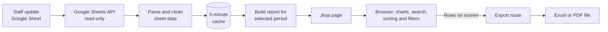

# Lloeva Beauty Business Dashboard


A full-stack analytics dashboard that turns a beauty salon's day-to-day Google Sheet into a live, shareholder-ready report. It tracks revenue, stock, commission and margin, with date filtering, interactive tables and one-click Excel and PDF export.

## Contents

- [The problem](#the-problem)
- [The solution](#the-solution)
- [Features](#features)
- [Skills demonstrated](#skills-demonstrated)
- [Architecture](#architecture)
- [Engineering decisions](#engineering-decisions)
- [Tech stack](#tech-stack)
- [Getting started](#getting-started)
- [Deploying to Vercel](#deploying-to-vercel)
- [Google Sheet layout](#google-sheet-layout)
- [Project structure](#project-structure)
- [Security](#security)
- [Known limitations](#known-limitations)
- [Author](#author)

## The problem

The business records its stock, daily sales, revenue and commission in a shared Google Sheet. That works well for data entry, but it leaves key questions hard to answer:

- How much did the business keep after product costs and commission?
- Which services and products earn the most?
- Which items need restocking, and how much money is tied up in stock that isn't selling?
- How does one week, month or quarter compare with another?

## The solution

The dashboard reads the sheet directly, so staff keep working the way they already do. Each page view is built from the latest cached data, and every figure is worked out from the sheet rather than typed in by hand.

## Features

### Date filtering

- Weekly, Monthly, Quarterly and Custom range views
- Period lists built automatically from the dates in the sheet
- Every tile, chart and table responds to the selected period

### Three colour-coded sections

| Section | Colour | Answers |
|---|---|---|
| **Stocks** | Plum | What is left, what it is worth, what to restock and what to hold |
| **Sales and revenue** | Rose | What was earned by day, weekday, service and product |
| **Commission and margin** | Teal | What was kept, what commission cost and which products are most profitable |

### Interactive tables

Every table includes:

- **Search** across the whole table
- **Sorting** on every column, with dates and weekdays sorted in their true order
- **A filter on every column**, including number rules such as `>10`, `<5` and `10-20`
- **Excel and PDF export** that keeps the current sort order and filters

### Decision support

- Headline tiles with plain-language explanations on hover
- Restock and hold lists generated from stock and sales data
- Automatic data checks that flag rows where the SALES and REVENUE tabs disagree
- Hand-drawn SVG charts with hover details
- Responsive layout for desktop and phone

## Skills demonstrated

| Area | What this project shows |
|---|---|
| **Backend development** | Flask routing, Jinja templates, input validation, in-memory caching and clear error handling |
| **API integration** | Service account authentication and batched, read-only access to the Google Sheets API |
| **Data engineering** | Parsing a human-maintained spreadsheet, including date serials, mixed cell types and missing values |
| **Business analytics** | Gross margin, cost of goods sold, stock valuation, sell-through and commission analysis |
| **Frontend development** | Search, sorting, filtering, tabs and tooltips written in plain JavaScript, with no framework |
| **Data visualisation** | Charts drawn directly as SVG with no chart library, and colours checked for colour-vision accessibility |
| **Document generation** | Formatted Excel workbooks with `openpyxl` and branded, paginated PDFs with `reportlab` |
| **UI and UX design** | A branded, responsive interface designed for non-technical readers, with keyboard-accessible controls |
| **Security** | Password sign-in, secure sessions, secret management, least-privilege access, output escaping and protection against spreadsheet formula injection |
| **Cloud deployment** | Serverless hosting on Vercel, with settings held in environment variables |

## Architecture



1. All four tabs are fetched in a single batched API call.
2. The parsed data is cached for five minutes, or until the user clicks **Refresh from sheet**.
3. Each request calculates its report from the cache, so switching periods needs no further API calls.
4. The browser handles charts, search, sorting and filtering.
5. Exports send the visible rows to Flask, which returns a finished file.

## Engineering decisions

**Calculations reflect how the business works.** Sales, revenue and commission cover only the selected period. Stock left counts all sales up to the end of that period, so choosing October shows stock as it stood on 31 October.

**The app keeps working through short outages.** If the sheet can't be reached, the page shows the last saved data with a clear warning.

**Exports match the screen.** The file contains the rows the user is looking at, in the same order. Excel files hold real numbers and percentages, so they can be added up and filtered straight away.

**No front-end dependencies.** Charts and table tools are written directly in JavaScript and SVG. There are no external scripts, stylesheets or build steps.

**The hosted app stays locked if it is set up wrongly.** Without a password and session key, the hosted app refuses all access rather than showing the report.

**Bad input is handled safely.** Invalid dates or filter values in the URL fall back to sensible defaults, and export requests are checked for shape and size.

## Tech stack

| Layer | Tools |
|---|---|
| Language | Python 3.13 |
| Web framework | Flask 3.1, Jinja2 |
| Data source | Google Sheets API, `gspread`, `google-auth` |
| Exports | `openpyxl`, `reportlab` |
| Frontend | HTML, CSS, JavaScript, SVG |

## Getting started

### Prerequisites

- Python 3.13 or later
- A Google Cloud project with the **Google Sheets API** enabled
- A service account key
- The Google Sheet shared with the service account's email address

### Installation

```bash
git clone <repository-url>
cd "Lloeva Beauty"
python -m venv .venv
```

Activate the virtual environment:

```bash
# Windows
.venv\Scripts\activate

# macOS or Linux
source .venv/bin/activate
```

Install the dependencies:

```bash
pip install -r requirements.txt
```

### Configuration

Copy `.env.example` to `.env` and fill in your values:

```env
SHEET_ID=your-google-sheet-id
GOOGLE_APPLICATION_CREDENTIALS="path/to/service-account-key.json"
```

You can paste the key's JSON into `.env` as `GOOGLE_APPLICATION_CREDENTIALS_JSON` instead of using a file path. Locally, the sign-in page only appears if you set `DASHBOARD_PASSWORD`.

### Run

```bash
python app.py
```

Then open [http://127.0.0.1:5009](http://127.0.0.1:5009).

## Deploying to Vercel

The repository is ready for Vercel: it finds the Flask `app` in `app.py`, and `.python-version` and `vercel.json` set the runtime.

1. Import the GitHub repository at [vercel.com/new](https://vercel.com/new). No build settings are needed.
2. Add these environment variables under **Settings > Environment Variables**, marked as Secret:

   | Variable | Value |
   |---|---|
   | `SHEET_ID` | The ID from the Google Sheet's URL |
   | `GOOGLE_APPLICATION_CREDENTIALS_JSON` | The service account key as JSON, on one line |
   | `DASHBOARD_PASSWORD` | The password people use to sign in |
   | `SECRET_KEY` | A long random value that signs the session cookie |

3. Deploy. Later pushes to `main` deploy automatically.

Changes to environment variables only apply after a redeploy. Changing `SECRET_KEY` signs everyone out.

## Google Sheet layout

The app expects four tabs with these exact names. `COMMISION` matches the spelling used in the sheet.

| Tab | Layout |
|---|---|
| `STOCKS` | Header row starting `PARTICULARS`, then item, quantity, total amount, unit cost and selling price |
| `SALES` | Header row starting `PARTICULARS`, then one column per date showing pieces sold or services offered |
| `REVENUE` | Same layout as `SALES`, showing the amount earned |
| `COMMISION` | Date in column A and amount in column B |

Writing `used` as the selling price marks an item as salon stock, which is left out of resale figures. Rows in `SALES` and `REVENUE` with no matching item in `STOCKS` are treated as services.

## Project structure

```text
Lloeva Beauty/
├── app.py               # Sheet access, calculations, routes and exports
├── requirements.txt     # Pinned Python dependencies
├── vercel.json          # Vercel function settings
├── .python-version      # Python version used by Vercel
├── templates/
│   ├── index.html       # Dashboard page, styles and browser logic
│   ├── login.html       # Sign-in page
│   └── error.html       # Friendly page shown if the sheet can't load
├── .env.example         # Template for the required settings
├── .env                 # Local secrets (not committed)
├── .vercelignore        # Keeps secrets out of CLI deployments
└── .gitignore
```

## Security

- **Password protected when hosted.** Every page and export requires sign-in, and sessions end after 12 hours.
- **Secure sessions.** Cookies are signed, sent only over HTTPS and hidden from page scripts.
- **Private responses.** Pages are not cached or indexed by search engines, and can't be embedded in other sites.
- **Secrets stay out of the repository.** `.env`, key files and exported reports are listed in `.gitignore`. Hosted secrets are stored as Vercel environment variables.
- **Least-privilege access.** The app requests read-only access and can't change the sheet.
- **Credentials stay on the server.** They are never sent to the browser.
- **Local runs stay local.** `python app.py` binds to `127.0.0.1`, so it can't be reached from other devices.
- **Safe output.** Jinja escapes page content, charts insert data as text, and PDF content is escaped.
- **Safe Excel files.** Item names are stored as plain text, so a cell starting with `=` can't run as a formula.

## Known limitations

- **Costs:** rent, wages and other running costs aren't in the sheet, so "Kept" is not final profit.
- **Stock quantity:** stock left assumes `QTY` is the quantity bought at the start, and it doesn't yet record restocks.
- **Access:** everyone shares one password, and there are no individual accounts. Wrong attempts are slowed but not locked out, so use a long password.
- **Hosting:** each Vercel instance keeps its own five-minute cache, so **Refresh from sheet** updates only the instance that handles it, and the last-saved-data fallback needs an instance that is already running.
- **Testing:** features were checked in a real browser during development, but the repository has no automated test suite yet.

## Author

**Lloyd Mwiti Mugo**

- Email: [lloydmwiti258@gmail.com](mailto:lloydmwiti258@gmail.com)
- LinkedIn: [linkedin.com/in/lloyd-mwiti-mugo-94066a243](https://www.linkedin.com/in/lloyd-mwiti-mugo-94066a243/)
